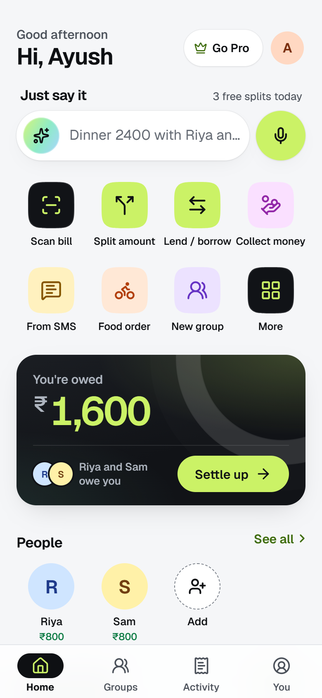
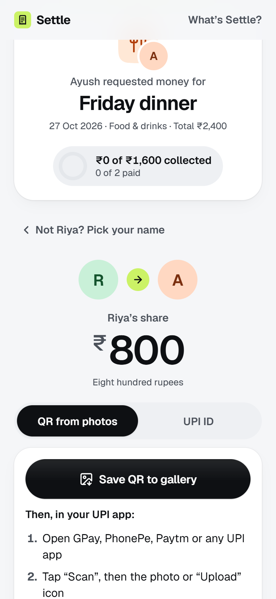
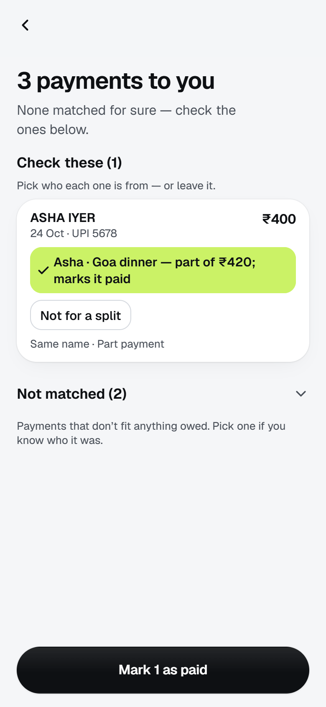
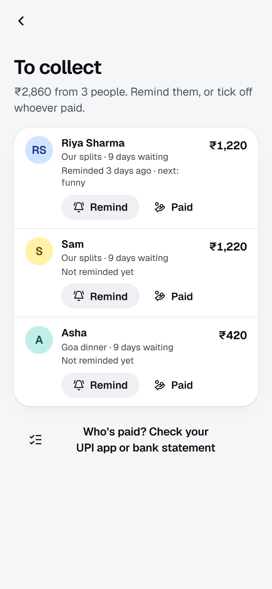
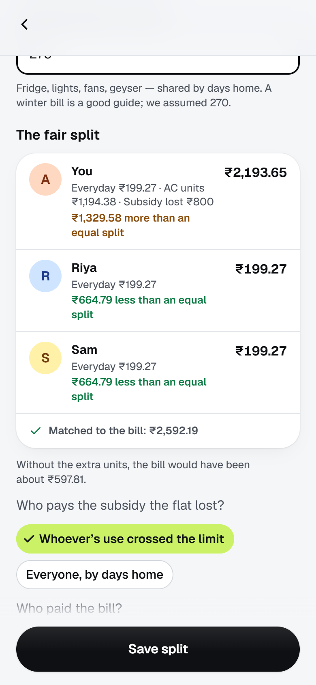
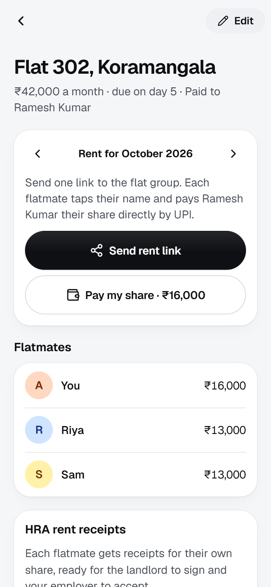
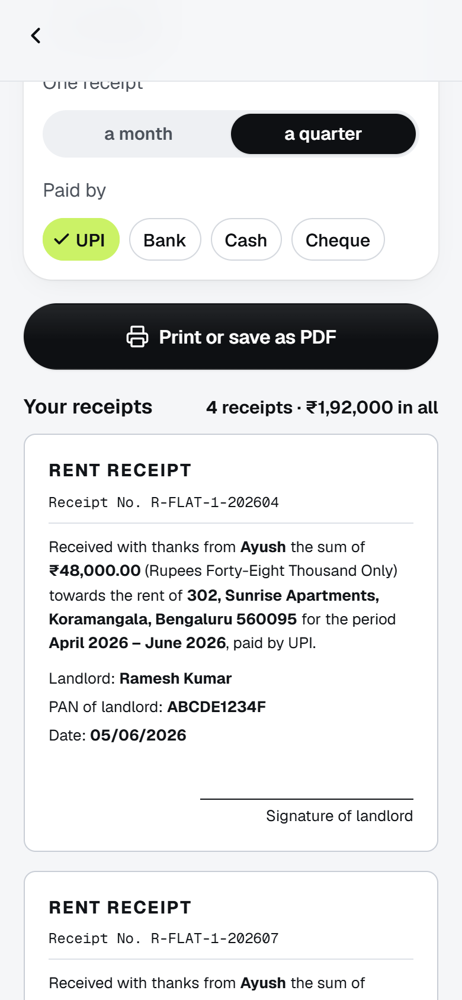
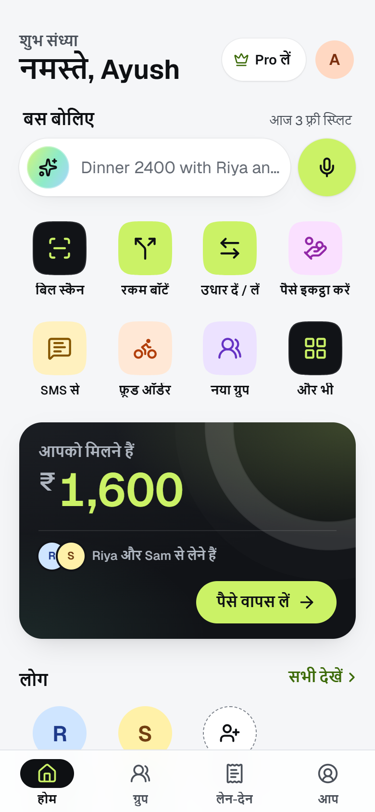

<div align="center">


# Settle

**Split anything. Settle in a tap.**

The bill-splitting app built for India: friends pay their exact share by UPI — in their own app, in their own language — without installing anything.

[](https://settleupi.vercel.app)
[](#built-for-india)
[](STATUS.md)
[](LICENSE)

**[Open the app](https://settleupi.vercel.app)** · **[Watch the film](docs/media/settle-promo.mp4)** · [What works and what doesn't](STATUS.md) · [Deploy your own](DEPLOY.md)

</div>

## Watch the film

<a href="docs/media/settle-promo.mp4"></a>

<p align="center"><sub>The first 8 seconds — <a href="docs/media/settle-promo.mp4"><b>watch the full film (1:16, 1080p)</b></a>. Music: "Hard - Hard Trap Beat" by vaitsez, <a href="https://pixabay.com/music/trap-hard-hard-trap-beat-582809/">Pixabay</a>.</sub></p>

## A look inside

<table>
  <tr>
    <td align="center" width="25%"><br><sub><b>Home</b><br>What you're owed, one tap to get it back</sub></td>
    <td align="center" width="25%"><br><sub><b>Pay, the ways UPI allows</b><br>QR, saved QR or UPI ID — no app to install</sub></td>
    <td align="center" width="25%"><br><sub><b>Who's paid?</b><br>Your statement ticks everyone off</sub></td>
    <td align="center" width="25%"><br><sub><b>To collect</b><br>A reminder each, in the right tone</sub></td>
  </tr>
  <tr>
    <td align="center" width="25%"><br><sub><b>Fair bijli</b><br>The AC user pays for the AC</sub></td>
    <td align="center" width="25%"><br><sub><b>Rent, split right</b><br>Everyone pays the landlord directly</sub></td>
    <td align="center" width="25%"><br><sub><b>HRA rent receipts</b><br>For your share, ready to sign</sub></td>
    <td align="center" width="25%"><br><sub><b>हिन्दी + 6 more</b><br>Every screen, eight languages</sub></td>
  </tr>
</table>

## Why Settle

Most split apps stop at *who owes whom* and leave the paying — and the chasing — to you. Settle is built around actually getting paid back, the way India pays.

- **Payments tick themselves off.** *New — Auto-settle, Android.* No split app knows when you've been paid: since UPI collect requests ended (Oct 2025), friends pay from whatever UPI app they like, and GPay, PhonePe and Paytm splits only see payments made inside their own app. In the Settle Android app, when Google Pay, PhonePe, Paytm, BHIM (or, if you allow it, your bank's SMS) tells you money arrived, Settle matches it to whoever owed you that amount and ticks them off — with Undo. A payment it isn't sure of waits for one tap. Nothing is uploaded: the alerts are read on your phone and every other notification is ignored. Friends still install nothing.

- **Friends don't install anything.** One link in the WhatsApp group, or a personal one each. Each friend taps their name, sees their exact share and pays it in their own UPI app — by your QR, a QR saved to their gallery, or your UPI ID, the ways UPI allows a payment to a person — then tells you **"I've paid"** in one tap.
- **Know who's paid, on any phone.** *New.* On iPhone and the web, drop your UPI app's history screenshots, a bank statement or your bank SMS, and Settle ticks off everyone who paid you back in one go — names, UPI IDs and amounts matched, part payments recognised, nothing ticked that it isn't sure of. Statements and SMS never leave your phone. Then **To collect** lists whoever's left, longest wait first, with a reminder each that gets firmer only as it needs to.
- **A second look at the bill.** *New.* Before a restaurant bill is split, Settle checks it for a service charge added by default (optional under the CCPA's 2022 guidelines), GST charged on it, service tax that ended in 2017 and totals that don't add up — with a polite note for the staff in eight languages.
- **Fair bijli.** *New.* The flat's electricity bill split by the tariff's slabs, days at home and AC nights, so whoever ran the AC pays for it — with ten Indian tariffs built in.
- **Rent, split right — with HRA receipts.** *New.* Each flatmate pays the landlord their own share directly from one rent link, so nobody fronts the whole rent and chases the others, and everyone has their own payment trail. Then Settle makes **HRA rent receipts for each flatmate's share** — monthly or quarterly, amount in words, the landlord's PAN when a share is over ₹1,00,000 a year, a revenue stamp for cash over ₹5,000 — ready for the landlord to sign and HR to file. We couldn't find another split app that does this.
- **Built for India.** Eight languages, voice that understands "dhai hazaar ka dinner", ₹ with lakh grouping, rupees by default, UPI everywhere, and fast on budget phones and slow networks.
- **AI that does the tedious part.** Snap a restaurant bill and every item, tax and discount is filled in; snap a Swiggy order and the delivery and platform fees are split fairly; drop a friend's payment screenshot and they're marked paid.
- **Private by design.** No sign-up, no ads, no database: your splits live on your phone.
- **Fair pricing.** Free for everyday splitting. Pro is a one-time pass — no auto-renewing subscription.

## Features

**Split anything**
- **Six ways to split** — equally, exact amounts, percentages, shares ("pays double"), item by item, or **what each had** for a meal with no bill (tax and tip shared in proportion), with optional rounding to whole rupees.
- **Bill check** — a default service charge, GST on it, old taxes and totals that don't add up, found before you split; one tap to split without them.
- **AI bill reading** — every item, tax, service charge and discount; then tap who had what. What you actually paid (after discounts and round-off) is shared in proportion.
- **Just say it** — type or speak "Cab 840 with Riya and Sam, Sam pays double" and get a ready-to-save split.
- **Food orders, fairly** — Swiggy, Zomato, Blinkit and Zepto fees kept apart and shared in proportion or equally.
- **From SMS** — paste or share a bank or UPI alert and it's ready to split; OTPs are refused.
- **Everyone claims their own items** — one claim link; friends tick what they had on their phones and the replies merge into the split.

**Get paid back**
- **One pay link per split**, or a personal link for each friend, with their exact share. On a computer they scan your QR (amount filled in); on a phone they save the QR to the gallery and upload it in their UPI app (up to ₹2,000, as UPI allows) or copy your UPI ID. They reply **"I've paid"** with the UPI reference, and you tick them off in one tap.
- **Auto-settle** (Android app) — UPI app and bank alerts that say money arrived tick off whoever paid, as it happens; unsure ones wait for a tap. Read on the phone, never uploaded.
- **Who's paid?** — UPI history screenshots (read by AI, not kept), a bank statement (CSV or Excel) or bank SMS (read on the phone) tick off everyone who paid you back at once, with Undo. Share a statement from your bank's app straight to Settle.
- **To collect** — everyone who owes you, the longest wait first, when you last reminded them, and the next reminder in the right tone; late at night it says the reminder can wait.
- **Paid? Drop the screenshot** — a GPay, PhonePe, Paytm or BHIM screenshot is read, matched to who owes you and marked paid after you confirm; pending, failed, mis-addressed and duplicate payments are refused.
- **Collect and nudge** — "₹1,840 of ₹2,766 collected", tick people off, send a friendly, funny or firm reminder.
- **Groups that settle themselves** — trips, flats and couples; the fewest payments to square everyone up, with a UPI QR for each.

**Everyday money with friends**
- **Rent & HRA receipts** — the flat's rent, paid to the landlord directly by each flatmate, with receipts for each share.
- **Fair bijli** — the electricity bill split by slabs, subsidies, AC nights and days at home, reconciled to the bill to the paisa.
- **Collections (chanda)** — one link for a birthday gift, a farewell, a Diwali party or a puja.
- **Udhaar** — lend or borrow in two taps, part payments, reminders.
- **Next round's on you** — groups that take turns paying see whose round it is.
- **Trips abroad** — spend in baht or dirhams, settle in ₹ at that day's ECB rate or at what your bank charged.
- **Share cards, recurring splits and insights** — a receipt image for the group chat, rent and subscriptions reminded monthly, spending by category and month.

### Built for India

- **Eight languages** on every screen: English, हिन्दी, বাংলা, मराठी, தமிழ், తెలుగు, ಕನ್ನಡ, ગુજરાતી — picked on the first screen or in You → Language. Pay links open in the friend's own language.
- **Speak to split** in all eight; number words like "dhai hazaar" become ₹2,500.
- **Indian formats** — ₹, lakh grouping (₹1,92,000), dates day-first.
- **Install it like an app** — straight from the browser (Android one tap, iPhone two steps), works offline after the first visit. No Play Store needed.

## Quick start

1. Get a free API key at [build.nvidia.com](https://build.nvidia.com) (Profile → API Keys). It starts with `nvapi-`.
2. Copy `.env.example` to `.env` and paste the key after `NVIDIA_API_KEY=`.
3. Install and run (Node 22.12 or newer):

   ```sh
   npm install
   npm run dev
   ```

4. Open the **Network** URL Vite prints (for example `http://192.168.1.20:5173`) on your phone, on the same Wi-Fi.

Everything except AI works without a key: split amounts by hand, type a bill in, or tap **Try a sample bill**.

## Free and Pro

| | Free | Pro |
| --- | --- | --- |
| Manual splits, groups, people, pay links, UPI QR, nudges, backup | Unlimited | Unlimited |
| AI bill scans and "Just say it" | 3 a day | Unlimited (fair use) |
| Recurring splits, insights, CSV export, accent colours | — | ✓ |
| Share cards without the "Made with Settle" line | — | ✓ |

Pro is sold as **one-time passes with no auto-renewal**: ₹49 for 30 days, ₹399 for a year, ₹999 for life (set your own with `PRO_PRICES`).

**How it works without a database:** payment goes through Razorpay; the server checks the payment signature, re-reads the order from Razorpay to confirm what was paid for, and returns an Ed25519-signed license. The app verifies it on the device. Promo and support codes are the same signed licenses:

```sh
npm run license keygen                                   # once: prints LICENSE_PRIVATE_KEY / LICENSE_PUBLIC_KEY for .env
npm run license issue -- --plan pro_yearly --id diwali   # prints a code anyone can redeem under You → Redeem a code
npm run license verify <code>
```

Without Razorpay keys the Pro page still shows the plans, says checkout isn't set up yet, and **Redeem a code** works. Use Razorpay test keys (`rzp_test_…`) to try real checkout safely.

## How the maths works

1. Every amount is kept in whole paise (or cents) — no floating-point money.
2. **Amount splits:** equal, exact, percentage and share modes divide the total by weight; leftover paise go out by the **largest-remainder method**, so the shares always add up to exactly the total. When rounding is involved, the payer absorbs it, so friends never pay a stray extra paisa.
3. **Bills:** each item is shared among the people who had it. What you actually paid (tax, service, tip and discounts included) is then shared **in proportion to each person's items** — someone who ordered 40% of the food pays 40% of the bill.
4. **Groups:** each member's balance is what they paid minus their shares, plus settlements. Balances always sum to zero, and a greedy matcher turns them into at most *n − 1* payments.

## Configuration

Set these in `.env` (for `npm run dev` and `npm start`) or in your host's environment. Everything is optional; `.env.example` documents each one.

| Variable | Default | What it does |
| --- | --- | --- |
| `NVIDIA_API_KEY` | (none) | Turns on AI bill scanning and "Just say it". |
| `NVIDIA_MODEL` | `nvidia/nemotron-3.5-super-vl-120b-a12b,nvidia/nemotron-3-nano-omni-30b-a3b-reasoning` | Vision models that read bill photos, tried in order. |
| `NVIDIA_TEXT_MODEL` | `nvidia/nemotron-3.5-lightning-30b-a3b,nvidia/nemotron-3-nano-omni-30b-a3b-reasoning` | Text models for "Just say it", tried in order. |
| `LICENSE_PRIVATE_KEY` / `LICENSE_PUBLIC_KEY` | (none) | Ed25519 key pair that signs Pro licenses (`npm run license keygen`). Without it Pro is off. |
| `RAZORPAY_KEY_ID` / `RAZORPAY_KEY_SECRET` | (none) | Turns on Pro checkout. |
| `PRO_PRICES` | `pro_monthly=4900,pro_yearly=39900,pro_lifetime=99900` | Prices in paise. |
| `PRO_AI_PER_DAY` | `200` | AI calls per Pro license per day. `0` = no cap. |
| `RATE_LIMIT_MAX` / `RATE_LIMIT_WINDOW_MS` | `30` / `600000` | Free AI calls per address per window. |
| `MAX_CONCURRENT_SCANS` | `8` | AI requests handled at once. |
| `TRUST_PROXY` | `0` | Set to the number of proxies in front of the app (usually `1` on Render, Fly.io, Railway, Heroku, nginx) so each user gets their own limits. |
| `PORT` / `HOST` | `3000` / all interfaces | Where `npm start` listens. |

## Scripts

| Command | What it does |
| --- | --- |
| `npm run dev` | App and API together with hot reload on port 5173 (also on your LAN). |
| `npm run build` | Typechecks, then builds the client to `dist/client` and the server to `dist/server`. |
| `npm start` | Runs the production build on port 3000. |
| `npm run check` | Typecheck, lint and the full test suite. |
| `npm run license` | Pro license keys and codes (see above). |

## Project structure

```
src/
  features/   screens: home, onboarding, split, expense, bill, groups, friends, activity, you,
              pro, insights, recurring, landing, legal, pay, claim, pools, lend, trip, proof, rent,
              bijli, whospaid, collect…
  kit/        feature components (people picker, split editor, share & UPI sheets…)
  components/ design system (buttons, sheets, charts, tab bar…)
  data/       on-device stores, actions and hooks (localStorage, no database)
  engine/     pure maths: split modes, balances, fewest payments, insights, recurring
  share/      pay links, share-card images, nudges
  pro/ ai/    Pro licenses, checkout, AI quota, "Just say it" client
  app/        router, app shell, theming
server/       Hono API: NVIDIA scan, describe, payment proof and history, Razorpay orders, licenses,
              security headers
shared/       types shared by the client and the server
scripts/      license CLI
```

## Deploy

Live at **[settleupi.vercel.app](https://settleupi.vercel.app)**. On Vercel's free plan it's `npx vercel deploy --prod` (see [DEPLOY.md](DEPLOY.md) for keys and the Cloudflare Pages + Render alternative).

Any Node host:

```sh
npm run build && npm start        # http://localhost:3000
```

Or with Docker:

```sh
docker build -t settle .
docker run --rm -p 3000:3000 --env-file .env settle
```

Serve it over **HTTPS**: browsers only enable offline mode, the native share sheet and the clipboard on secure origins. On a host with a proxy in front (most of them), also set `TRUST_PROXY=1`. The server adds security headers and compression, caches built assets for a year, and the app installs as a PWA that opens offline after one visit.

## Privacy

- **No database and no accounts.** Nothing about you or your splits is stored on the server.
- **Photos and "Just say it" text go to NVIDIA only to be read**, and the server keeps nothing.
- **Pay links carry the split in the link itself** (after the `#`), which browsers never send to the server.
- **Everything else stays in your browser** — people, expenses, groups and settings — with a backup file you can export and restore.

## License

Settle is **proprietary software — all rights reserved.** You may use the app at [settleupi.vercel.app](https://settleupi.vercel.app), but the source code, design and assets in this repository may not be copied, modified, redistributed or used to build another product without written permission. See [LICENSE](LICENSE). Open-source components keep their own licences: [THIRD-PARTY-NOTICES.md](THIRD-PARTY-NOTICES.md).

## Credits

Made by Ayush. Promo film music: "Hard - Hard Trap Beat" by vaitsez, from [Pixabay](https://pixabay.com/music/trap-hard-hard-trap-beat-582809/) (Pixabay Content License). Type: Geist (Vercel). Icons: Lucide. Bill reading: NVIDIA models. Exchange rates: European Central Bank.
